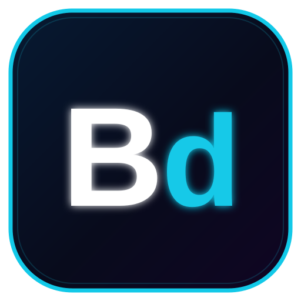

<p align="center">
  
</p>

# Interactive Birthday Experience

A standalone, space-themed birthday microsite built as a personalised digital celebration.

## Highlights

- Animated visual effects and layered backgrounds
- Interactive 3D elements powered by Three.js
- Custom typography, motion, and celebration effects
- Responsive single-page experience

## Run Locally

No build tooling is required. Open `diva-v1-cyber.html` in a modern browser, or serve the repository locally:

```bash
python -m http.server 8000
```

Then visit `http://localhost:8000/diva-v1-cyber.html`.

The page loads some visual assets and libraries from external CDNs, so an internet connection is required for those resources.
